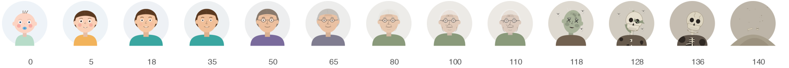

# age-picker

A dependency-free `<birthday-picker>` web component: month, day and year dropdowns with an
avatar that ages to match the selected birth year. Hover or arrow through the year list and
the avatar previews that age before you commit.

<p align="center">
  
</p>

- Ages 0 to 110: baby to centenarian. Hair grays and thins, wrinkles, glasses and age spots arrive gradually.
- Ages 111 to 140: a corpse that decays, skin falling away to a skull, then crumbling to dust.
- The avatar is drawn gender-neutral.
- One script tag, no framework, no build step. Works in plain HTML, React, Vue and Svelte.

**Live demo:** https://rderr.github.io/age-picker/

<p align="center">
  
</p>

<p align="center">
  
</p>

## Quick start

Load the single-file bundle and drop in the tag:

```html
<script src="https://cdn.jsdelivr.net/gh/rderr/age-picker@main/dist/birthday-picker.bundle.js"></script>
<birthday-picker name="birthday"></birthday-picker>
```

Or copy `dist/birthday-picker.bundle.js` into your site and load it locally. The bundle
contains the component and all 141 avatars as inlined SVGs, so nothing else needs hosting.
It is about 600 KB on disk and roughly 60 KB gzipped.

## Other ways to install

### Script plus avatar folder

Copy `birthday-picker.js` and the `avatars/` folder next to each other:

```html
<script src="birthday-picker.js"></script>
<birthday-picker name="birthday"></birthday-picker>
```

The avatar folder is resolved relative to the script's own URL. To host the images
elsewhere, point at them explicitly (this also overrides the inlined set in the bundle):

```html
<birthday-picker avatars="/static/img/avatars/"></birthday-picker>
```

### npm

```
npm install github:rderr/age-picker
```

Then import `age-picker` once (it registers the element) or copy the bundle from
`node_modules/age-picker/dist/`.

### Frameworks

`<birthday-picker>` is a standard custom element. Load the script once, then use the tag.
Listen for its `change` event with `addEventListener`; React's `onChange` does not bind
custom events.

## Attributes

| Attribute  | Meaning                                                         |
| ---------- | --------------------------------------------------------------- |
| `name`     | Form field name. Submits `YYYY-MM-DD` when placed inside a form. |
| `value`    | Initial value, `YYYY-MM-DD`.                                     |
| `avatars`  | Folder containing the avatar SVGs.                               |
| `min-year` | Oldest year in the dropdown (default: current year minus 140).   |
| `max-year` | Newest year in the dropdown (default: current year).             |
| `hide-age` | Hide the "Age N" caption under the avatar.                       |

## JavaScript API

```js
const el = document.querySelector("birthday-picker");
el.value;   // "1990-06-15" or "" until all three parts are chosen
el.year;    // 1990
el.month;   // 6
el.day;     // 15
el.age;     // whole years as of today, null if no year chosen

el.addEventListener("change", (e) => {
  console.log(e.detail); // { year, month, day, age, value }
});
```

## Keyboard

The year control is a custom listbox rather than a native `<select>`, which is what makes
the live preview possible.

- Open list: hover or Up/Down previews the avatar. Enter or click commits, Escape reverts.
- Closed list: Up/Down change the year directly. PageUp/PageDown move ten years. Home/End jump to the newest and oldest year.
- Typing digits such as `198` jumps to that decade.

## Styling

The component uses Shadow DOM. Override its CSS custom properties, or target parts:

```css
birthday-picker {
  --bp-avatar-size: 160px;
  --bp-accent: #e11d48;
  --bp-font: Georgia, serif;
}
birthday-picker::part(select) { border-radius: 2px; }
```

Variables: `--bp-avatar-size`, `--bp-gap`, `--bp-font`, `--bp-text`, `--bp-muted`,
`--bp-border`, `--bp-bg`, `--bp-accent`, `--bp-highlight`, `--bp-radius`.
Parts: `avatar`, `age`, `fields`, `select`, `month`, `day`, `year`, `year-list`.

## Development

```
python3 generate-avatars.py   # draws avatars/age-000.svg … age-140.svg
python3 build.py              # inlines them into dist/birthday-picker.bundle.js
open index.html               # local demo using the avatars/ folder
```

Both scripts are Python 3 with no dependencies. The avatar artwork is entirely
parametric: `generate-avatars.py` interpolates face shape, hair, skin and clothing across
age, so a change to one curve regenerates the whole set.

## License

MIT
